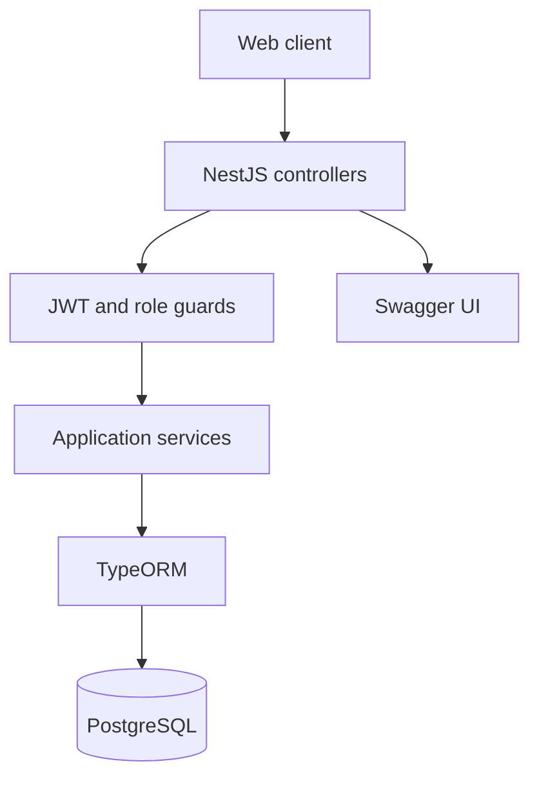

[Versão em português](README.md)

# Hero App — Backend

REST API for a hero, project, and battle management application. The backend centralizes authentication, business rules, and persistence for the [Hero App Frontend](https://github.com/leoo1992/hero-app-front).

## Problem and solution

Provides users with distinct access roles, hero registration, related projects, and battle operations through a documented API. Authentication uses JWT, role-based route protection, and request throttling.

## Demo and screenshots

- **Live API:** <!-- PREENCHER: demo -->
- **Local Swagger:** http://localhost:3001/api/docs
- **Screenshots:** <!-- PREENCHER: API/Swagger screenshots -->

## Stack

- Node.js 20+, TypeScript, and NestJS 11
- PostgreSQL, TypeORM, and bcrypt
- JWT, Passport, Swagger, and throttling
- Docker Compose, Jest, and ESLint

## Architecture



**Decisions:** NestJS structures modules, controllers, and services; PostgreSQL stores relational data; TypeORM maps entities; JWT avoids server-side sessions; bcrypt stores password hashes. Docker Compose simplifies local setup.

## Run locally

Requirements: Node.js 20+, npm, and PostgreSQL.

```bash
git clone https://github.com/leoo1992/hero-app-back.git
cd hero-app-back
npm install
cp .env.example .env
npm run start:dev
```

On PowerShell, run `Copy-Item .env.example .env`. Configure PostgreSQL and generate a unique random `JWT_SECRET` in `.env`.

## Docker

```bash
docker compose up -d
npm install
npm run start:dev
```

Compose starts the database; run the API with the local Node process. Swagger is available at `http://localhost:3001/api/docs`.

### Admin seed

Set `ADMIN_EMAIL` and `ADMIN_PASSWORD` in `.env` before running:

```bash
npm run seed
```

The seed aborts if either variable is missing or the password is shorter than 12 characters. Passwords are stored using bcrypt.

## Tests and quality

```bash
npm run build
npm test -- --runInBand
npm run format
```

Jest is configured in `jest.config.ts`. The formatting command runs Prettier over TypeScript files under `src`. There is no `lint` script in `package.json`.

## Security

- Never commit `.env`; environment files are ignored and only `.env.example` is tracked.
- Keep unique `JWT_SECRET`, database, and admin credentials outside Git.
- Admin credentials have no code-level defaults.

## Limitations and next steps

- Add PostgreSQL integration tests.
- Review migrations and disable `synchronize` in production.
- Publish a live demo URL and real API documentation screenshots.

## License

MIT.
