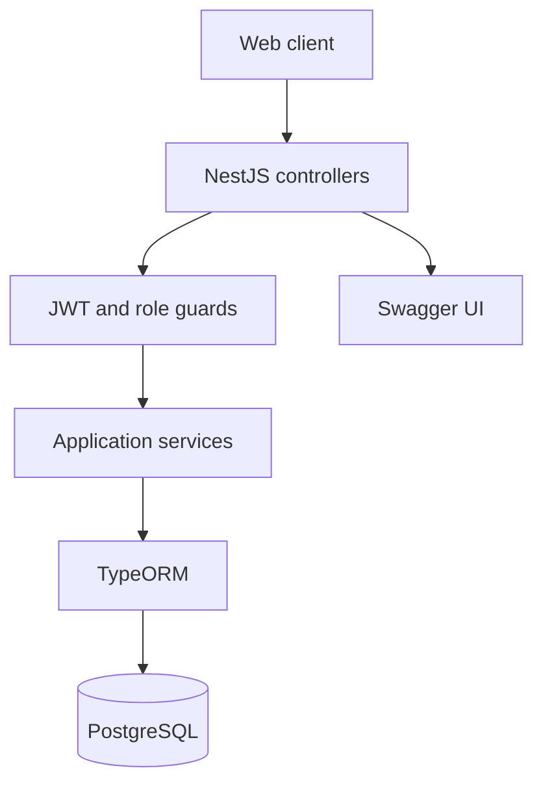

[English version](README.en.md)

# Hero App — Backend

API REST para uma aplicação de gestão de heróis, projetos e batalhas. O backend centraliza autenticação, regras de negócio e persistência para o [Hero App Frontend](https://github.com/leoo1992/hero-app-front).

## Problema e solução

Organiza usuários com papéis distintos, cadastro de heróis, projetos associados e operações de batalha em uma API documentada. A autenticação usa JWT; rotas podem ser protegidas por papel de acesso e há limitação de requisições.

## Demo e imagens

- **API em produção:** <!-- PREENCHER: demo -->
- **Swagger local:** http://localhost:3001/api/docs
- **Screenshots:** <!-- PREENCHER: screenshots da API/Swagger -->

## Stack

- Node.js 20+, TypeScript e NestJS 11
- PostgreSQL, TypeORM e bcrypt
- JWT, Passport, Swagger e throttling
- Docker Compose, Jest e ESLint

## Arquitetura



**Decisões:** NestJS organiza módulos, controllers e serviços; PostgreSQL mantém os dados relacionais; TypeORM integra entidades e persistência; JWT evita sessão de servidor; bcrypt armazena hashes de senha. O Docker Compose simplifica o ambiente local.

## Como executar

### Local

Pré-requisitos: Node.js 20+, npm e PostgreSQL.

```bash
git clone https://github.com/leoo1992/hero-app-back.git
cd hero-app-back
npm install
cp .env.example .env
npm run start:dev
```

No PowerShell, use `Copy-Item .env.example .env`. Edite o `.env` com a conexão PostgreSQL e gere um `JWT_SECRET` aleatório e exclusivo.

### Docker

```bash
docker compose up -d
npm install
npm run start:dev
```

O Compose inicia o banco; a API é executada pelo Node local. A documentação Swagger fica em `http://localhost:3001/api/docs`.

### Seed administrativo

Configure `ADMIN_EMAIL` e `ADMIN_PASSWORD` no `.env` antes de executar:

```bash
npm run seed
```

A seed aborta se as variáveis estiverem ausentes ou se a senha tiver menos de 12 caracteres. A senha é persistida com bcrypt.

## Testes e qualidade

```bash
npm run build
npm test -- --runInBand
npm run format
```

O projeto configura Jest em `jest.config.ts`; o comando de formatação usa Prettier nos arquivos TypeScript de `src`. Não há script `lint` declarado no `package.json`.

## Segurança e configuração

- Nunca versione `.env`; o repositório ignora arquivos de ambiente e mantém apenas `.env.example`.
- `JWT_SECRET`, senha do banco e credenciais administrativas devem ser únicas e mantidas fora do Git.
- Credenciais administrativas não possuem valor padrão no código.

## Limitações e próximos passos

- Adicionar pipeline de testes de integração com PostgreSQL.
- Revisar migrações e desabilitar `synchronize` em produção.
- Publicar uma URL de demonstração e capturas reais da documentação.

## Licença

MIT.
